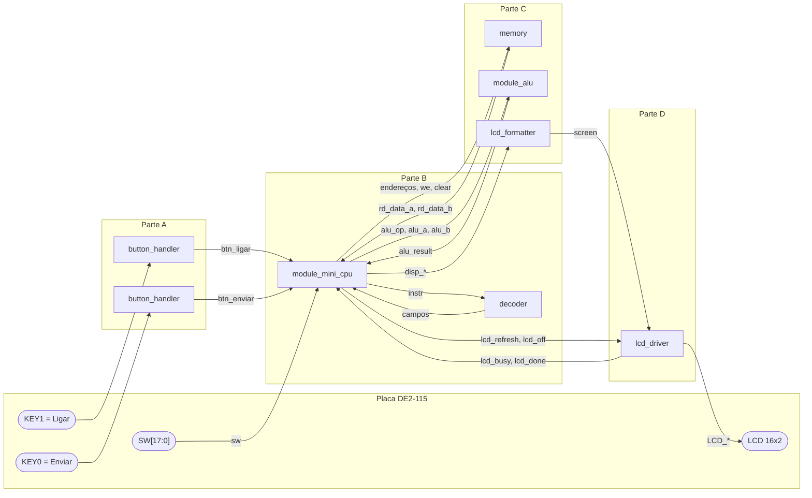
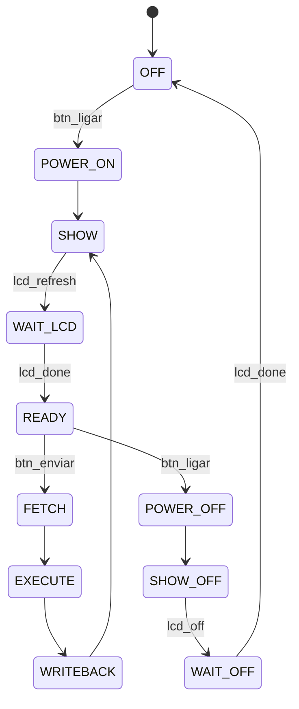

# Divisão do projeto

Cada pessoa fica com uma parte. Os arquivos de `rtl/` já existem com as portas abaixo: é só preencher o corpo.
Antes de começar, leia o [guia de Git](GIT.md).

## 1. As 4 partes

| Parte | O que faz | Arquivos |
|---|---|---|
| **A: Placa e botões** | Transforma os botões em pulsos limpos, liga tudo aos pinos e testa o sistema completo | `top_de2_115.v`, `button_handler.v` |
| **B: Controle (CPU)** | Coordena tudo: liga/desliga, lê a instrução, manda calcular, guardar e mostrar | `module_mini_cpu.v`, `decoder.v` |
| **C: Cálculo, memória e texto** | Faz as contas, guarda os 16 registradores e monta o texto da tela | `module_alu.v`, `memory.v`, `bin2bcd.v`, `lcd_formatter.v` |
| **D: LCD** | Escreve os 32 caracteres no LCD e apaga a tela | `lcd_driver.v` |

Cada parte também faz o testbench dos seus módulos em `sim/`.

## 2. Como as partes se ligam

O nome em cada seta é o nome exato da porta.



Só a CPU conversa com todo mundo. A única ligação que não passa pela CPU é a `screen`, que vai do formatador direto para o driver.

## 3. Regras para todos

- Um único clock (`clk`, 50 MHz) e sempre `always @(posedge clk)`. Nunca usar um botão como clock.
- `rst` é síncrono e ativo em 1.
- **Pulso** = fica em 1 durante exatamente 1 ciclo de clock.
- Valores de 16 bits são **com sinal** (complemento de 2). Use `$signed()` nas contas.
- Opcodes e tipos de tela estão em `rtl/defines.vh` (`` `OP_ADD ``, `` `DISP_RESULTADO ``…).
- **Não mude nenhuma porta** sem combinar com quem está do outro lado.

## 4. Instruções nos switches

O opcode fica **sempre** em `SW[17:15]`. `Rd` fica sempre em `[14:11]` e `Rs1` sempre em `[10:7]`.

```
            17  15 14   11 10    7  6   5          0
Reg x Reg  [ op  ][  Rd   ][  Rs1  ][   Rs2   ][ - - - ]
Imediato   [ op  ][  Rd   ][  Rs1  ][ S ][   |Imm|    ]
LOAD       [ op  ][  Rd   ][ - - - - ][ S ][  |Imm|    ]
CLEAR      [ op  ][ - - - - - - - - - - - - - - - ]
DISPLAY    [ op  ][ - - - - ][  Rs1  ][ - - - - - - - ]
```

Imediato: `S` = sinal (1 = negativo) + 6 bits de valor, ou seja, de −63 a +63. `-` = bit ignorado.

| Opcode | Instrução | Faz | LCD |
|---|---|---|---|
| `000` | `LOAD Rd, Imm` | `Rd = Imm` | `LOAD` |
| `001` | `ADD Rd, Rs1, Rs2` | `Rd = Rs1 + Rs2` | `ADD` |
| `010` | `ADDI Rd, Rs1, Imm` | `Rd = Rs1 + Imm` | `ADDI` |
| `011` | `SUB Rd, Rs1, Rs2` | `Rd = Rs1 − Rs2` | `SUB` |
| `100` | `SUBI Rd, Rs1, Imm` | `Rd = Rs1 − Imm` | `SUBI` |
| `101` | `MUL Rd, Rs1, Imm` | `Rd = Rs1 × Imm` (16 bits de baixo) | `MUL` |
| `110` | `CLEAR` | zera R0..R15 | só `CLEAR` |
| `111` | `DISPLAY Rs1` | mostra `Rs1` | `DPL` |

**O enunciado tem alguns erros.** Adotamos (confirmar com o monitor):
- O opcode fica sempre em `SW[17:15]` (no enunciado, cada formato põe o opcode num lugar diferente, o que não dá para decodificar).
- `SUB` faz `Rs1 − Rs2` (o enunciado diz "copia", o que é erro de copiar e colar).
- Se o resultado passar de 16 bits, ele "dá a volta" (overflow).
- R0 é um registrador normal.
- No `DISPLAY`, o número entre colchetes é o do registrador mostrado.

## 5. Testes esperados

Sequência a partir do sistema recém-ligado. `·` = espaço.

| # | Instrução | `SW[17:0]` | Linha 1 do LCD | Linha 2 do LCD |
|---|---|---|---|---|
| 0 | (ligar) | — | `------····[----]` | `··········+00000` |
| 1 | `LOAD R2, 12` | `000_0010_0000_0_001100` | `LOAD······[0010]` | `··········+00012` |
| 2 | `ADD R1, R0, R2` | `001_0001_0000_0010_000` | `ADD·······[0001]` | `··········+00012` |
| 3 | `SUBI R3, R1, 20` | `100_0011_0001_0_010100` | `SUBI······[0011]` | `··········-00008` |
| 4 | `MUL R4, R3, -5` | `101_0100_0011_1_000101` | `MUL·······[0100]` | `··········+00040` |
| 5 | `SUB R5, R4, R1` | `011_0101_0100_0001_000` | `SUB·······[0101]` | `··········+00028` |
| 6 | `ADDI R6, R5, -63` | `010_0110_0101_1_111111` | `ADDI······[0110]` | `··········-00035` |
| 7 | `DISPLAY R2` | `111_0000_0010_0_000000` | `DPL·······[0010]` | `··········+00012` |
| 8 | `LOAD R7, 63` | `000_0111_0000_0_111111` | `LOAD······[0111]` | `··········+00063` |
| 9 | `MUL R7, R7, 63` | `101_0111_0111_0_111111` | `MUL·······[0111]` | `··········+03969` |
| 10 | `MUL R7, R7, 63` (overflow) | `101_0111_0111_0_111111` | `MUL·······[0111]` | `··········-12097` |
| 11 | `CLEAR` | `110_0000_0000_0_000000` | `CLEAR···········` | (vazia) |
| 12 | `DISPLAY R7` | `111_0000_0111_0_000000` | `DPL·······[0111]` | `··········+00000` |
| 13 | (desligar) | — | (apagado) | (apagado) |
| 14 | (ligar) + `DISPLAY R2` | `111_0000_0010_0_000000` | `DPL·······[0010]` | `··········+00000` |

---

## Parte A: Placa e botões

**`button_handler`**: gera **1 pulso quando o botão é solto**.

| Porta | Bits | Dir | Descrição |
|---|---|---|---|
| `btn_n` | 1 | in | pino `KEY` (0 = apertado) |
| `released` | 1 | out | pulso ao soltar |

- Passar `btn_n` por 2 flip-flops (sincronizar), depois debounce de 20 ms (parâmetro `DEBOUNCE_CYCLES`) e então detectar a passagem de apertado para solto.
- No reset, considerar o botão solto (para não sair pulso falso).

**`top_de2_115`**: já vem pronto. Ligar = `KEY[1]`, Enviar = `KEY[0]`. LEDs de debug: `LEDR` = switches, `LEDG[8]` = sistema ligado, `LEDG[7]` = LCD ocupado, `LEDG[3:0]` = estado da CPU.

**Pronto quando:** cada soltura gera exatamente 1 pulso, e todos os testes da seção 5 funcionam na placa.

---

## Parte B: Controle (CPU)

**`decoder`** (combinacional): separa os campos da instrução (posições na seção 4).

| Saída | Bits | Descrição |
|---|---|---|
| `opcode`, `rd`, `rs1`, `rs2` | 3, 4, 4, 4 | campos da instrução |
| `imm` | 16 | imediato já convertido para complemento de 2 |
| `use_imm` | 1 | LOAD, ADDI, SUBI, MUL |
| `reg_write` | 1 | todas, menos CLEAR e DISPLAY |
| `is_clear`, `is_display` | 1 | tipo especial |

**`module_mini_cpu`**: máquina de estados. Não calcula, não guarda registradores e não fala com o LCD diretamente.

| Porta | Ligação |
|---|---|
| `mem_rd_addr_a` / `_b` | sempre `rs1` / `rs2` |
| `alu_op`, `alu_a`, `alu_b` | sempre `opcode`, `R[rs1]`, `use_imm ? imm : R[rs2]` |
| `mem_wr_addr`, `mem_wr_data` | sempre `rd`, `resultado` |
| `mem_we`, `mem_clear` | 1 só nos estados indicados abaixo |
| `disp_kind`, `disp_opcode`, `disp_reg`, `disp_value` | registradores: o que mostrar no LCD |
| `lcd_refresh`, `lcd_off` → `lcd_busy`, `lcd_done` | pedido ao driver e resposta |

**Diagrama de estados sugerido:**



| Nº | Estado | Faz |
|---|---|---|
| 0 | OFF | nada; Enviar é ignorado |
| 1 | POWER_ON | `mem_clear`, tela inicial |
| 2 | SHOW | pulso em `lcd_refresh` (quando `lcd_busy = 0`) |
| 3 | WAIT_LCD | espera `lcd_done` |
| 4 | READY | espera um botão |
| 5 | FETCH | `instr <= sw` |
| 6 | EXECUTE | `resultado <= alu_result` |
| 7 | WRITEBACK | grava `resultado` em `rd` (ou `mem_clear` no CLEAR; no DISPLAY, nada) e atualiza `disp_*` |
| 8 | POWER_OFF | `mem_clear` |
| 9 | SHOW_OFF | pulso em `lcd_off` (quando `lcd_busy = 0`) |
| 10 | WAIT_OFF | espera `lcd_done` |

Se Ligar for apertado no meio de uma instrução, guarde o pedido e trate no READY.

**Pronto quando:** todos os testes da seção 5 passam em simulação (com um "LCD falso" no testbench que responde `lcd_done`).

---

## Parte C: Cálculo, memória e texto

**`module_alu`** (combinacional): recebe `op`, `a`, `b` e devolve `result` (16 bits).

| op | result |
|---|---|
| LOAD | `b` |
| ADD, ADDI | `a + b` |
| SUB, SUBI | `a - b` |
| MUL | 16 bits de baixo de `a * b` |
| CLEAR, DISPLAY | `0` |

**`memory`**: 16 registradores de 16 bits (`reg [15:0] regs [0:15]`).
- Leitura combinacional em 2 portas (`rd_addr_a` → `rd_data_a`, `rd_addr_b` → `rd_data_b`).
- Escrita na borda do clock quando `we = 1`.
- `clear` ou `rst` zeram todos. `clear` tem prioridade sobre `we`.

**`bin2bcd`** (combinacional): número de 16 bits → 5 dígitos BCD (algoritmo *double dabble*).

**`lcd_formatter`** (combinacional): transforma `kind`, `opcode`, `reg_num` e `value` nos 32 caracteres de `screen`. O caractere `i` fica em `screen[255-8*i -: 8]`, então dá para escrever direto `screen = "ADD       [0001]          +00012";`. Os textos de cada tela estão na tabela da seção 5.

**Pronto quando:** os testbenches comparam a saída com os valores e textos da seção 5 e tudo passa.

---

## Parte D: LCD

**`lcd_driver`**: escreve no LCD o que vier em `screen`.

| Porta | Dir | Descrição |
|---|---|---|
| `refresh` | in | pulso: escrever a tela |
| `power_off` | in | pulso: apagar a tela |
| `screen` | in | 32 caracteres |
| `busy` | out | 1 enquanto trabalha |
| `done` | out | pulso ao terminar |
| `LCD_*` | out | pinos do LCD (`RW`, `ON` e `BLON` sempre: 0, 1 e 1) |

| Quando | Comandos enviados |
|---|---|
| Reset | esperar 20 ms → `0x38`, `0x08`, `0x01`, `0x06` (tela fica apagada) |
| `refresh` | `0x0C` (se estava apagada) → `0x80` + 16 caracteres → `0xC0` + 16 caracteres |
| `power_off` | `0x01`, `0x08` |

Cada byte: colocar `RS` e `DATA`, `EN = 1` por ~1 µs, `EN = 0` e esperar 1 ms (2 ms depois do `0x01`).

**Pronto quando:** uma tela fixa aparece na placa e apaga corretamente. Teste na placa cedo: é a parte com mais risco de hardware.

---

## Como juntar

1. Cada pessoa trabalha na sua branch (`parte-a`, `parte-b`, …), mexendo só nos seus arquivos (passo a passo no [guia de Git](GIT.md)).
2. Testbench passando → pull request para a `main`. Como as portas não mudam, nada quebra.
3. Com as 4 partes na `main`, rodar os testes da seção 5 na placa. Se travar, os LEDs mostram onde: switches, estado da CPU e LCD ocupado.
